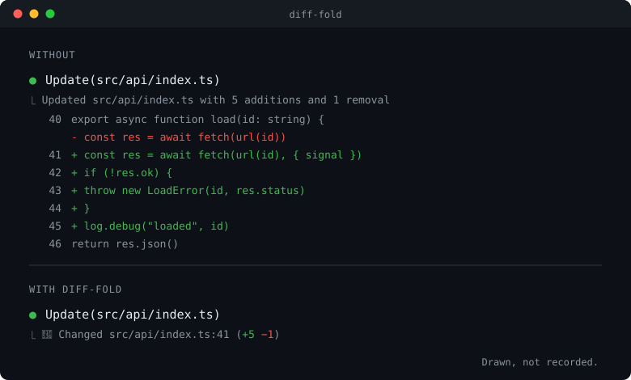

<p align="center">
  <picture>
    <source media="(prefers-color-scheme: dark)" srcset="docs/images/banner-dark.svg">
    
  </picture>
</p>

A Claude Code mod that shows one summary line per file instead of the diff under a finished edit.
A long diff pushes the conversation out of view, and once the edit is done you rarely read it there:



_Drawn, not recorded._

The path is relative to the project, the number after the colon is the first changed line, and the counts are green and red.
A change in more than one place says how many follow the first, `Changed src/a.ts:41 and 2 more places (+12 −4)`, as an edit with
`replace_all` or a rewrite of a whole file often is. A change that moves only whitespace, a reindent or trailing spaces taken
out, says that too: `Changed src/a.ts:41 (+12 −12, whitespace only)`.
Small diffs, diffs held for your review, failed edits and changes to sensitive files such as `.env` stay in full.
To see a folded diff, press ctrl+o: the expanded transcript shows every diff in full. Under the fullscreen layout ctrl+o keeps
the summaries; click **▸ show diff** under one to open that diff (**▾ hide diff** folds it again), or switch them all with
`/diff-fold`. The button is drawn only there: the main screen reports no clicks, and ctrl+o already does the job.

Folding changes only what the transcript shows. The files and what Claude sees stay as they are, and `git diff` or your
editor still shows every change in full, the place to look when edits are accepted without asking.

## Install

Needs Claude Code 2.1.287 or later, the first version that runs mods. Tested with Claude Code 2.1.314. Run inside Claude Code:

```text
/plugin marketplace add muellerei/diff-fold
/plugin install diff-fold@muellerei-diff-fold
```

The second command opens the plugin's page. Choose **Install for you (user scope)** and the mod is active right away.

From a clone instead: `claude --plugin-dir /path/to/diff-fold`.

Ideas, questions and a quick "works on my setup" are all welcome: [CONTRIBUTING.md](CONTRIBUTING.md).

### Update and remove

Claude Code does not update plugins from this marketplace on its own. To get a new version, run this in a terminal and restart
Claude Code:

```text
claude plugin marketplace update muellerei-diff-fold
claude plugin update diff-fold@muellerei-diff-fold
```

You can also turn on auto-update for the marketplace under `/plugin`, Marketplaces.

`claude plugin uninstall diff-fold@muellerei-diff-fold` removes the mod, `claude plugin marketplace remove muellerei-diff-fold` the
marketplace. `claude plugin disable diff-fold@muellerei-diff-fold` switches it off and keeps it installed.

## What it folds

| Tool                                                        | Summary                                                                               |
| ----------------------------------------------------------- | ------------------------------------------------------------------------------------- |
| Edit                                                        | `Changed <path>:<line> (+N −M)`                                                       |
| Write, new file                                             | `Created <path> (+N −0)`                                                              |
| Write, existing file                                        | `Changed <path>:<line> (+N −M)`                                                       |
| NotebookEdit (one cell of a Jupyter notebook, `.ipynb`)     | `Changed <notebook> cell <id> (+N −M)`                                                |
| Bash that changed files ([needs a setting](#bash-commands)) | the command's own output, then one line per file, up to three, and `and N more files` |

A `Changed` line from Edit, Write or Bash whose change is in more than one place adds how many follow the line it names:
`Changed <path>:<line> and N more places (+N −M)`. One whose change moves only indentation, trailing spaces or blank lines ends
in `(+N −M, whitespace only)`. Files in which whitespace carries meaning never get the note: Python, YAML, Makefiles, Markdown,
reStructuredText, TSV, patches, and indentation-based languages such as Haskell, F#, CoffeeScript, Pug or Sass. The list is not
complete, so a language missing from it gets the note like any other file. Nor does a change get it where text spans lines, in a
template literal, a triple-quoted string, a heredoc or after a trailing backslash, since there the indentation is content.

Left in full:

- a change of `smallDiffLines` lines or fewer (5 by default); for a Bash command, the lines of all its files together
- an edit or write that is only proposed and not yet written to disk: the diff is what you have to judge
- a failed call
- a change to a sensitive file, however large, in upper or lower case alike. A Bash command that changed one of them among
  others shows its whole diff.
  - secrets and credentials: `.env*`, `.npmrc`, `.netrc`, `.pypirc`, keys (`*.pem`, `*.key`, `id_rsa*`, `id_ecdsa*`,
    `id_ed25519*`) and anything in `.ssh/`
  - what runs on its own, as a side effect of committing, installing or opening the folder: `.git*` files such as
    `.gitattributes` and `.gitlab-ci.yml`, anything in `.git/`, `.husky/`, `.github/workflows/`, `.github/actions/` and
    `.devcontainer/`, `.pre-commit-config.yaml`, lefthook and mise configuration, `package.json` (its install scripts),
    `setup.py`, `.vscode/tasks.json`, `.devcontainer.json`, `.mcp.json` and `hooks.json`
  - what steers Claude or another agent: `settings*.json`, `CLAUDE.md`, `AGENTS.md`, `GEMINI.md`,
    `.github/copilot-instructions.md`, and in `.claude/` the folders `agents`, `commands`, `skills`, `hooks`, `rules` and
    `output-styles`

  The rule for the list: a change to the file acts without anyone reading it. Configuration that runs nothing itself, such
  as `pyproject.toml`, and lockfiles are folded.

  A file is matched on its name, a folder on its path: a folder named `.env` or a file `settings.ts` is folded as usual, and so
  are Claude's own notes such as `.claude/plans/`

- everything while the transcript is expanded (ctrl+o, `--verbose` or `"verbose": true` in the settings), on the main screen;
  the fullscreen layout folds regardless

There is no line above the prompt and no key binding to set up.

## Bash commands

Edit, Write and NotebookEdit always come with a diff, so diff-fold folds them without any setup. A Bash command is different:
Claude Code shows which files a command changed only when it records them. It may do that by itself in the `auto` and
`bypassPermissions` modes, though not for every account, and its setting
[`bashEditDiffEnabled`](https://code.claude.com/docs/en/settings-reference#basheditdiffenabled) makes it record them in every
permission mode.

| `bashEditDiffEnabled` | What a `sed -i` over three files shows                                        |
| --------------------- | ----------------------------------------------------------------------------- |
| off                   | the command's output only: there is no diff, so diff-fold has nothing to fold |
| on, without diff-fold | the command's output, then the full diff of every changed file                |
| on, with diff-fold    | the command's output, then one line per changed file                          |

With the setting on, a Bash call that changed five files ends like this, a new or removed file named so:

```text
🔶 Changed src/a.ts:12 and 3 more places (+8 −8)
🔶 Created src/b.ts (+40 −0)
🔶 Deleted src/c.ts (+0 −22)
🔶 and 2 more files
```

A file Claude Code has no diff for, such as a binary one, is named without counts next to the files that have one:
`🔶 Changed assets/logo.png (no diff)`. A call that changed only such files has nothing to fold, and Claude Code draws it itself. A
file too large to diff leaves the whole call without a diff; Claude Code then says so itself and diff-fold has nothing to fold.

To turn it on, add this line to your user settings, `~/.claude/settings.json`, and start a new session:

```json
"bashEditDiffEnabled": true
```

- It has to be the user settings (or settings your organization manages). Claude Code doesn't take this setting from a
  project's `.claude/settings.json`.
- The environment variable `CLAUDE_CODE_BASH_EDIT_DIFF=1` does the same and wins over the setting; `0` turns it off.
- Claude Code records the changes only inside a git repository. Outside one, a Bash command that changes files shows its output
  only, setting or not, and diff-fold has nothing to fold (measured, Claude Code 2.1.316). Edit and Write are folded anywhere.
- diff-fold can't turn it on for you: a mod has no way to change Claude Code's own settings.
- The command's own output (test results, a listing) is never folded, only the diff of the files it changed.
- Without the setting there was no diff here in the `acceptEdits` and the `bypassPermissions` mode alike (measured, Claude
  Code 2.1.314).

## Switching

`/diff-fold` switches between summaries and full diffs and says which is on. The choice is kept across sessions.

Under the fullscreen layout each summary also has a **▸ show diff** button that opens just that diff; **▾ hide diff** folds it
again. Which diffs are open is not kept: a new session starts with all of them folded.

## Settings

In `/config`, under the mod:

| Setting          | Default |                                                                                      |
| ---------------- | ------- | ------------------------------------------------------------------------------------ |
| `smallDiffLines` | `5`     | Diffs with this many changed lines or fewer are shown in full. `0` folds every diff. |
| `icon`           | `🔶`    | The mark at the start of each summary line. Empty for none.                          |

For Bash commands Claude Code's own setting `bashEditDiffEnabled` matters too; see [Bash commands](#bash-commands).

## What it can reach

- **Reads:** the result Claude Code draws under each Edit, Write, NotebookEdit and Bash call (the paths, the diff and its counts),
  and the project folder when the session starts, so paths stay relative to it.
- **Writes:** no files. Whether diffs are hidden is kept in the mod's store in Claude Code, so `/diff-fold` holds across
  sessions; which rows are open lives in the session only. With `--debug-file`, one line per result: the tool and the decision,
  never a path or text from the result.
- **Network and processes:** none.

`claude plugin validate .` lists every call the hooks make.

## Other mods

diff-fold draws only the result block under Edit, Write, NotebookEdit and file-changing Bash calls. It leaves tool rows, grouped
rows and the area above the prompt alone.

A mod that also shortens Write results (shellcast does) meets diff-fold there. Nothing breaks: whichever of the two comes first in
the chain draws the line you see.

## Credits

diff-fold started as a fork of [hide-diffs](https://github.com/gixxy22/hide-diffs) by gixxy22 (MIT). The idea of folding a diff
into one line comes from there, and so do the summary line, its counting rules, the 🔶 icon and the small-diff threshold. Thank you,
gixxy22. See [NOTICE](NOTICE).

hide-diffs does more than that: it also folds every shell command to one line, counts the session's changes in a line above the
prompt, has a compact mode, and needs two key bindings set up for its switches. diff-fold keeps only the core, folding diffs, and
nothing else, so there is no line above the prompt, no key binding and nothing to set up. If you want the rest, use hide-diffs.

## Support

Report problems and ideas as issues at https://github.com/muellerei/diff-fold/issues, or start a discussion at
https://github.com/muellerei/diff-fold/discussions. Say which Claude Code version you use, main screen or fullscreen layout, and
what the line showed. If you would like to help, [CONTRIBUTING.md](CONTRIBUTING.md) is the place to start.

## License

MIT, see [LICENSE](LICENSE).
